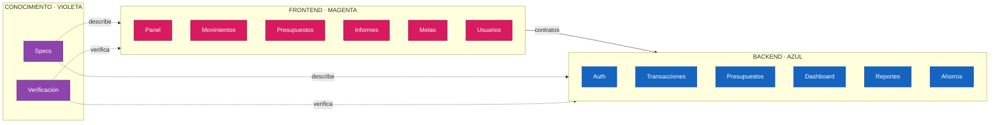

# Mapa de FinanTrack

Este es el índice navegable del proyecto. Los repositorios contienen la evidencia primaria; este vault conecta arquitectura, proceso, specs, desarrollo y documentación de módulos.

🧠 Canvas central: [[00 - Mapa de FinanTrack.canvas]]

## Dos cerebros principales

### 🩷 Frontend

[[Cerebro - Frontend]]

### 🔷 Backend

[[Cerebro - Backend]]

## Cerebros transversales

- [[Cerebro - Arquitectura]]
- [[Cerebro - Cómo trabajamos]]
- [[Cerebro - Specs]]
- [[Cerebro - Desarrollo]]
- [[Cerebro - Documentación]]

Los módulos no cuelgan directamente del mapa: pertenecen a su cerebro de capa y desde allí se conectan con los cerebros transversales.

## División principal de cerebros

### 🩷 Cerebro Frontend

| Núcleo | Módulos |
|---|---|
| Arquitectura | [[Cerebro - Arquitectura]] · capa de presentación |
| Specs | [[Cerebro - Specs]] · aceptación de pantallas y contratos consumidos |
| Desarrollo | [[Cerebro - Desarrollo]] · features, UI, hooks y checks |
| Documentación | [[Cerebro - Documentación]] · guías, evidencias y enlaces frontend |

### 🔷 Cerebro Backend

| Núcleo | Módulos |
|---|---|
| Arquitectura | [[Cerebro - Arquitectura]] · API, reglas, persistencia y seguridad |
| Specs | [[Cerebro - Specs]] · requisitos, OpenAPI y aceptación funcional |
| Desarrollo | [[Cerebro - Desarrollo]] · módulos, pruebas y contratos |
| Documentación | [[Cerebro - Documentación]] · evidencia, operación y límites de API |

Frontend y backend se conectan únicamente mediante contratos explícitos.

## Leyenda de grupos por color

| Color | Grupo | Etiqueta | Uso |
|---|---|---|---|
| 🟣 Morado | Mapa | `#grupo/mapa` | Índices y navegación |
| ⚫ Gris azulado | Arquitectura | `#grupo/arquitectura` | Capas, contratos y límites |
| 🔵 Cian | Proceso | `#grupo/proceso` | SDD, Git y decisiones |
| 🟡 Ámbar | Specs | `#grupo/specs` | Requisitos y aceptación |
| 🟢 Verde | Desarrollo | `#grupo/desarrollo` | Roadmap, tareas y checks |
| 🟪 Violeta | Documentación | `#grupo/documentacion` | Fuentes, evidencia y mantenimiento |
| 🩷 Magenta | Frontend | `#grupo/frontend` | Pantallas, hooks y consumo de API |
| 🔷 Azul | Backend | `#grupo/backend` | API, reglas y persistencia |
| 🟤 Terracota | Contrato | `#grupo/contrato` | OpenAPI y fronteras entre capas |

## Grafo técnico

## Regla de clasificación

1. Pantallas, hooks y estado visual → `#grupo/frontend`.
2. Reglas, API, persistencia y autorización → `#grupo/backend`.
3. Contratos entre capas → `#grupo/contrato`.
4. Requisitos y aceptación → `#grupo/specs`.
5. Evidencia, proceso y decisiones → el grupo documental correspondiente.

