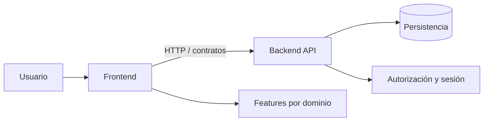

# 🧭 Arquitectura

> [!architecture] Propósito
> Entender las piezas del sistema, sus responsabilidades y los límites que no debemos cruzar.

🗺️ Canvas visual: [[Arquitectura.canvas]]

## Mapa del sistema

## Grupos

| Grupo | Responsabilidad | Color |
|---|---|---|
| Aplicación | Composición, rutas y proveedores | Índigo |
| Features | Pantallas, hooks, tipos y API por dominio | Índigo |
| Shared | Piezas reutilizables sin reglas propias | Índigo |
| API | Persistencia, cálculos financieros y autorización | Índigo |
| Contratos | Frontera entre frontend y backend | Índigo |

## Dominios

`auth` · `account/users` · `dashboard` · `transactions` · `budgets` · `reports` · `savings-goals`

`notifications` está planificado; no asumir que ya existe en la API.

## Límites de diseño

- Las features no dependen de detalles internos de otras features.
- Las reglas financieras, validaciones y autorización pertenecen al backend.
- El cliente consume contratos y presenta agregados; no recalcula reglas financieras.
- Moneda: BOB. Importes JSON: strings decimales con dos posiciones.
- Zona horaria: `America/La_Paz`.

## Fuente

Consultar `fintrackFrontend/docs/architecture.md`, `fintrackBackend/docs/architecture.md` y los contratos vigentes antes de cambiar este mapa.

