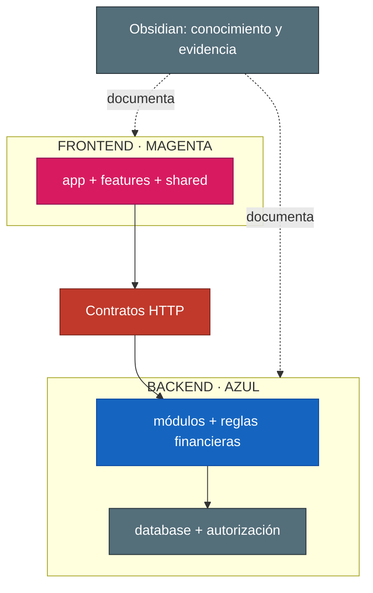

# Cerebro de arquitectura

Este cerebro responde **cómo está construido FinanTrack** y qué responsabilidad tiene cada capa.

## Frontera

- Recibe de negocio: prioridades y capacidades.
- Recibe de specs: comportamiento, estados y aceptación.
- Entrega: módulos, contratos, datos, seguridad y despliegue.
- No decide: reglas de producto que no estén documentadas.

## Núcleos

- [[01-Arquitectura/Arquitectura - Inicio]]
- [[10 - Frontend - Panel]]
- [[20 - Backend - Auth y sesiones]]
- [[Cerebro - Specs]]

## División Frontend / Backend

### 🩷 Frontend

- `app`: composición, rutas y proveedores.
- `features`: panel, movimientos, presupuestos, informes, metas, usuarios y auth.
- `shared`: piezas reutilizables sin reglas financieras propias.
- Consume contratos HTTP y presenta agregados.

### 🔷 Backend

- `modules`: auth, users, transactions, dashboard, budgets, savings-goals, reports y notifications.
- `database`: persistencia, migraciones y seeds.
- `shared`: guards, pipes, filtros y utilidades transversales.
- Es dueño de reglas financieras, autorización y persistencia.

## Capas

## Reglas técnicas

- Las features no dependen de detalles internos de otras features.
- Las reglas financieras y la autorización pertenecen al backend.
- El frontend presenta agregados y no recalcula reglas financieras.
- Moneda BOB, importes JSON como strings decimales y zona `America/La_Paz`.

