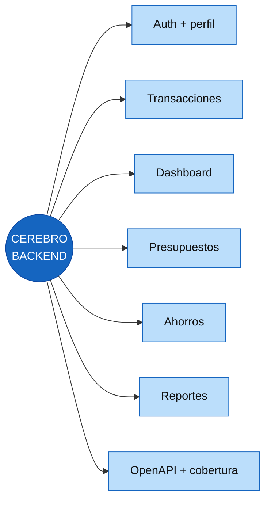

# Cerebro Backend

Este es el centro de todas las neuronas backend. Todo lo que vive aquí pertenece a API, reglas financieras, autorización y persistencia.

## Neuronas de módulo

- [[20 - Backend - Auth y sesiones]]
- [[21 - Backend - Perfil]]
- [[22 - Backend - Transacciones y categorías]]
- [[23 - Backend - Dashboard]]
- [[24 - Backend - Presupuestos]]
- [[25 - Backend - Ahorros]]
- [[26 - Backend - Reportes]]
- [[27 - Backend - Notificaciones]]

## Neuronas transversales

- [[Cerebro - Arquitectura]]
- [[Cerebro - Cómo trabajamos]]
- [[Cerebro - Specs]]
- [[Cerebro - Desarrollo]]
- [[Cerebro - Documentación]]

## Código

`fintrackBackend/src/modules/` · `fintrackBackend/src/database/` · `fintrackBackend/docs/`

