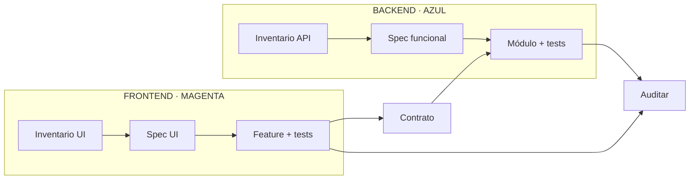

# Cerebro de cómo trabajamos

Responde **cómo pasamos de una necesidad a una entrega comprobada**.

## Núcleos

- [[02-Como-trabajamos/Como trabajamos - Inicio]]
- [[Cerebro - Specs]]
- [[Cerebro - Desarrollo]]

## División Frontend / Backend

### 🩷 Flujo Frontend

Inventario de pantalla → spec de interacción → contrato consumido → implementación de feature → tests UI → evidencia.

### 🔷 Flujo Backend

Inventario de comportamiento → spec funcional → contrato/API → implementación de módulo → tests de servicio → evidencia.

El punto de coordinación entre ambos es el contrato; una capa no inventa el comportamiento de la otra.

## Ciclo SDD

## Reglas

- Separar `OBSERVADO`, `RECOMENDACIÓN` y `DEPENDENCIA EXTERNA`.
- Ejecutar solo la tarea autorizada.
- Registrar comando, resultado, fecha y SHA.
- Un merge local no equivale a publicar.

