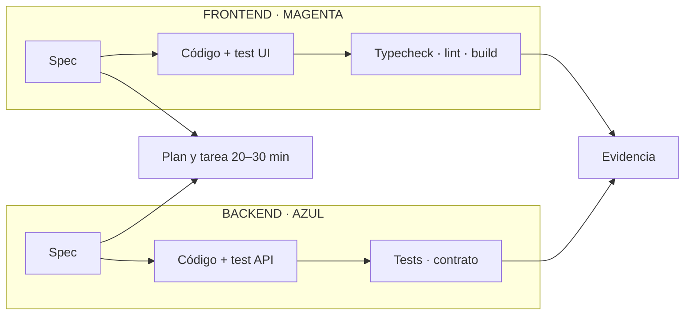

# Cerebro de desarrollo

Responde **qué se está construyendo, en qué orden y con qué comprobaciones**.

## Núcleos

- [[04-Desarrollo/Desarrollo - Inicio]]
- [[Cerebro - Cómo trabajamos]]
- [[Cerebro - Documentación]]

## División Frontend / Backend

### 🩷 Desarrollo frontend

- Trabajar en `fintrackFrontend/src/features/`.
- Mantener UI, hooks, tipos y acceso al contrato dentro del dominio.
- Ejecutar typecheck, lint, tests y build aplicables.
- No duplicar reglas financieras del backend.

### 🔷 Desarrollo backend

- Trabajar en `fintrackBackend/src/modules/`.
- Mantener DTOs, entidades, servicios, controladores y autorización dentro del módulo.
- Ejecutar tests de servicio/API y validación de contrato.
- Entregar cambios de contrato antes de exigirlos al frontend.

## Entrega de una feature

## Criterio de terminado

La tarea cumple “Hecho cuando”, los estados de éxito/error/vacío están considerados, los checks se ejecutaron y la documentación afectada quedó actualizada.

