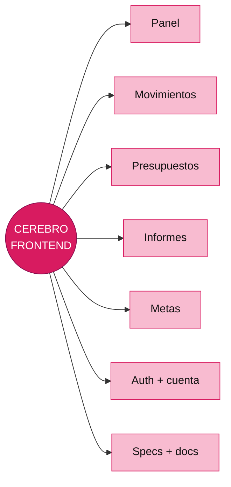

# Cerebro Frontend

Este es el centro de todas las neuronas frontend. Todo lo que vive aquí pertenece a la experiencia, composición y consumo de contratos del cliente.

## Neuronas de módulo

- [[10 - Frontend - Panel]]
- [[11 - Frontend - Movimientos]]
- [[12 - Frontend - Presupuestos]]
- [[13 - Frontend - Informes]]
- [[14 - Frontend - Metas]]
- [[15 - Frontend - Usuarios]]
- [[16 - Frontend - Notificaciones]]
- [[17 - Frontend - Auth]]
- [[18 - Frontend - Cuenta]]

## Neuronas transversales

- [[Cerebro - Arquitectura]]
- [[Cerebro - Cómo trabajamos]]
- [[Cerebro - Specs]]
- [[Cerebro - Desarrollo]]
- [[Cerebro - Documentación]]

## Código

`fintrackFrontend/src/app/` · `fintrackFrontend/src/features/` · `fintrackFrontend/docs/`

